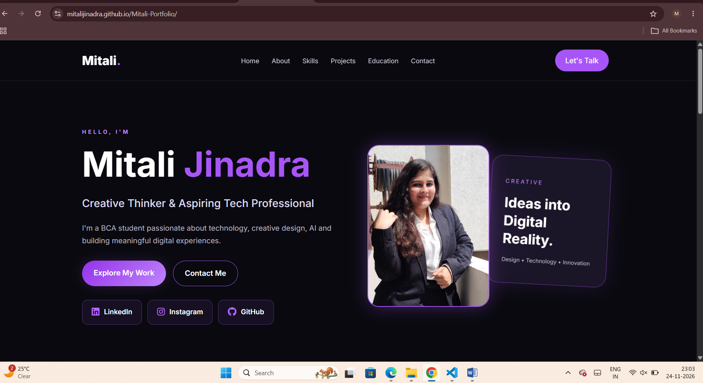

# ✨ Mitali Jinadra | Personal Portfolio

Welcome to my personal portfolio repository!

I'm Mitali Jinadra, a BCA student at Christ College, Saurashtra University, passionate about technology, creative design, and exploring Artificial Intelligence.

## 🌐 Live Portfolio
[Visit My Portfolio](https://mitalijinadra.github.io/Mitali-Portfolio/)

## 👩‍💻 About Me
- BCA Student (2024–2027)
- Interested in Artificial Intelligence and Data Science
- Exploring Web Development, UI/UX and Creative Technologies
- Passionate about learning and building projects

## 🛠️ Skills

- HTML & CSS
- Java, Python and C#
- SQL & MySQL
- WordPress
- Canva and Photoshop
- After Effects
- UI/UX Basics
- Digital Marketing

## 🚀 Featured Projects

### 1. TrustEdu – Fraud Detection
An AI-focused project exploring fraud detection and the identification of potentially fraudulent activities.

### 2. Student Management System
A web-based project designed to organise and manage student information and academic records.

### 3. Bhagwati Gold Website
A jewellery website developed using WordPress, featuring product pages, an About section and a contact form.

## 📱 Connect With Me

- [LinkedIn](https://www.linkedin.com/in/mitali-jinadra-56059240b/)
- [Instagram](https://www.instagram.com/mitalijinaadra_121/)
- [GitHub](https://github.com/MitaliJinadra)

---

⭐ Thank you for visiting my portfolio!